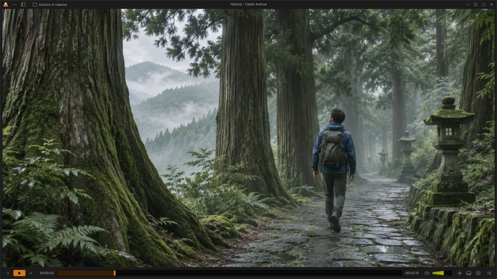
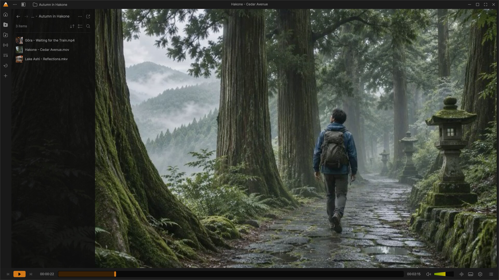
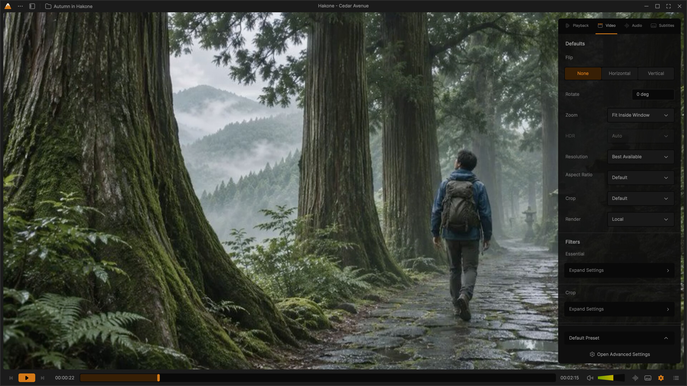
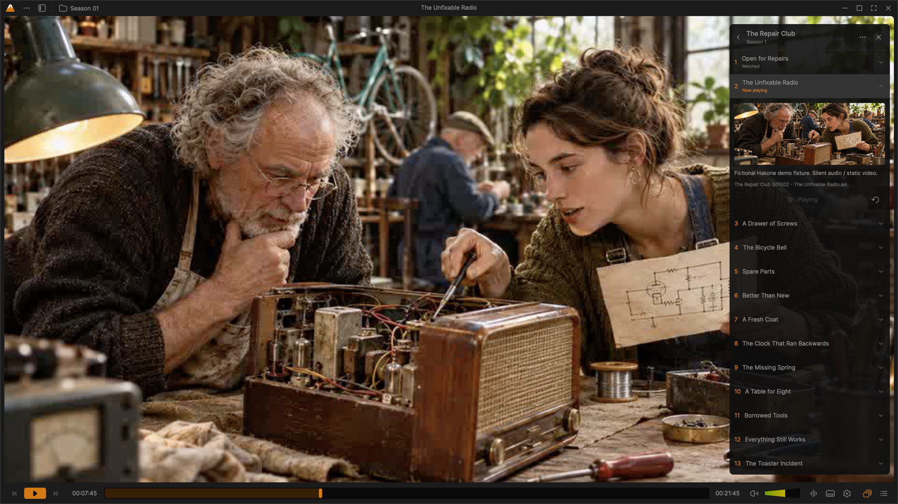
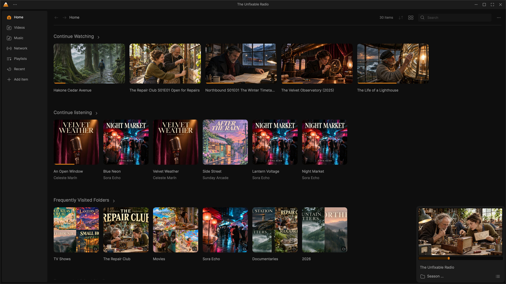

# Hakone Media Player

**Hakone** is a free and open source media player for Windows, macOS and Linux.
It pairs a redesigned, modern interface with a playback engine that handles
almost any file, disc, stream or device.

Hakone is in beta. Download it from [hakone.org](https://hakone.org/) or the
[Releases page](https://github.com/hakone-org/hakone/releases).



| Library sidebar | Video settings |
| --- | --- |
|  |  |

| Episodes | Home |
| --- | --- |
|  |  |

## Features

- **A player that stays out of the way:** floating controls, a compact mode,
  and a layout you can rearrange and save as presets.
- **Your library:** browse local folders, music, series and podcasts, resume
  where you left off, and see your saved progress as you browse.
- **Subtitles and metadata:** search for subtitles online, match episodes and
  artwork, and correct what the player identified.
- **Add-ons:** extend the player with episode guides, metadata providers, media
  sources, themes and visualizers from the [Hakone add-on registry](https://addons.hakone.org/).
- **Plays almost everything:** local files, discs, network streams and capture
  devices, with conversion and streaming built in.
- **Your look:** light and dark themes, accent colours, and the interface in
  many languages.

## Download

| Platform | Requirements |
| --- | --- |
| Windows | Windows 10 (1809 or later) or Windows 11, x64 |
| macOS | Apple Silicon or Intel |
| Linux | x86_64, glibc 2.35 or later (Ubuntu 22.04 or equivalent) |

Get the latest build from [hakone.org](https://hakone.org/) or the
[Releases page](https://github.com/hakone-org/hakone/releases).

## Add-ons

Add-ons are sandboxed packages that the player runs in a separate process,
with only the permissions you accept. Hakone ships with a few add-ons turned
on, and you can find more on [addons.hakone.org](https://addons.hakone.org/).

To write your own, start with [contrib-addons/README.md](contrib-addons/README.md)
and the [add-on SDK](contrib-addons/sdk/README.md).

## Building from source

- [Linux](doc/BUILD-linux.md)
- [macOS](doc/BUILD-macos.md)
- [Windows](doc/BUILD-win32.md)

Release packaging and the `1.0.0-beta.N` version scheme are described in
[doc/RELEASING.md](doc/RELEASING.md).

## Contributing

Hakone is developed at [github.com/hakone-org/hakone](https://github.com/hakone-org/hakone).
Report bugs and request features in the
[issue tracker](https://github.com/hakone-org/hakone/issues), and send changes
as pull requests.

The interface is written in C++ and QML on Qt and lives in
[modules/gui/qt](modules/gui/qt). Most of the engine is C, with some C++,
Objective-C, assembly and Rust.

Help is welcome with code, packaging, documentation, design, translations
and support.

## Credits

Hakone is based on [VLC media player](https://www.videolan.org/vlc/), made by
the volunteers of the VideoLAN community. Hakone uses VLC's engine, libVLC, and
keeps its name and API.

The redesigned interface is adapted from **VLC Redesign**
by [Juxtopposed](https://www.juxtopposed.com/), licensed under
[Creative Commons Attribution 4.0 International (CC BY 4.0)](https://creativecommons.org/licenses/by/4.0/).
The original design is available on
[Figma Community](https://www.figma.com/community/file/1691465999134370980/vlc-redesign),
with a [video walkthrough](https://www.youtube.com/watch?v=ERFeOgqk324).
This implementation modifies the design for the player's native interface,
including responsive layouts, interactive controls, settings organization, and
integration with playback and media library features. The design credit and
CC BY 4.0 notice apply to the original design; the software licenses are
described below.

The interface uses [Inter](https://rsms.me/inter/) by Rasmus Andersson and contributors.
The bundled fonts use the [SIL Open Font License 1.1](modules/gui/qt/fonts/LICENSE.txt).

## License

Hakone is released under the GPLv2 *(or later)* license. On some platforms
it is de facto GPLv3, because of the licenses of its dependencies.

libVLC, the engine, is released under the LGPLv2 *(or later)* license.

Hakone is a modified version of VLC media player, and VLC's copyright and
license notices still apply. See [COPYING](COPYING), [COPYING.LIB](COPYING.LIB),
[AUTHORS](AUTHORS) and [THANKS](THANKS).

## Source code layout

```
bin/               - Hakone executables.
compat/            - Compatibility library for systems missing
                     essential functions.
contrib/           - Scripts that fetch and build external libraries.
contrib-addons/    - Bundled add-ons and the add-on SDK.
doc/               - Build guides and other documentation.
extras/package     - Packaging and release tooling.
extras/tools/      - Scripts that fetch and build required build tools.
include/           - Header files.
lib/               - libVLC source code.
modules/           - Plugins and modules. Most of the code is here.
                     The Hakone interface is in modules/gui/qt.
po/                - Translations.
share/             - Icons, desktop files and other resources.
src/               - libvlccore source code.
test/              - Tests.
```
