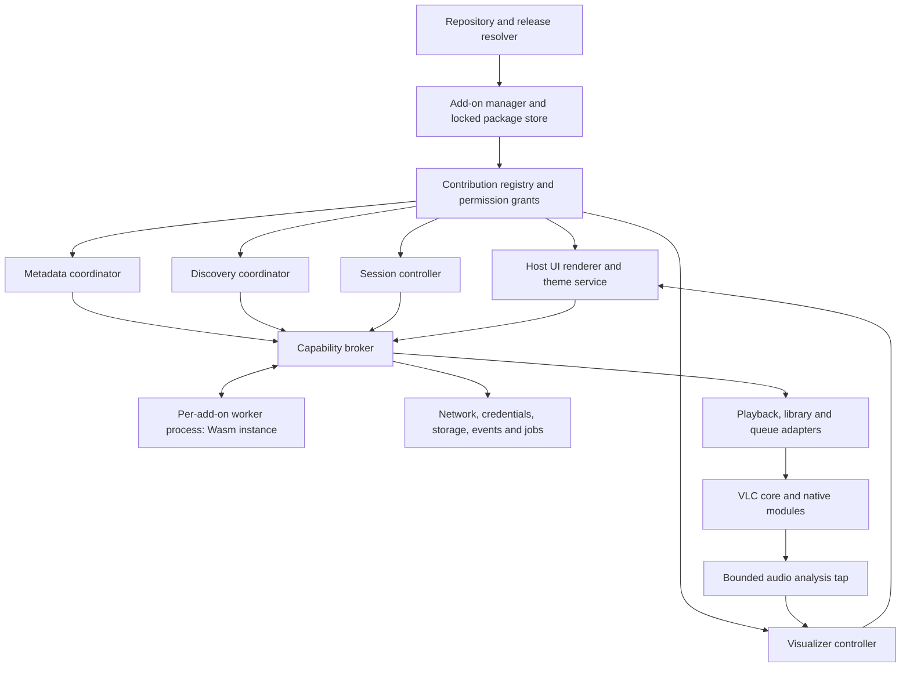

# Architecture and runtime

See [the overview](README.md) for scope and [the delivery plan](06-delivery-plan.md) for current source integration points. Names in this document are proposed public contracts.

## Ownership and data flow



These are ownership boundaries, not a requirement for one C++ class per box.

| Owner | Responsibilities |
| --- | --- |
| Add-on manager | Package identity, trust, release selection, compatibility, grants, enablement, staged activation, recovery and uninstall |
| Contribution registry | Validates namespaced contributions, supported contracts and hook eligibility; publishes an atomic active generation |
| Capability broker | Authorizes every call, checks object handles/context, enforces limits, routes asynchronous completions and revokes authority |
| Metadata coordinator | Sole remote metadata orchestration path; provider profiles, cache, matching, provenance and transactional application |
| Discovery coordinator | Browse/search sessions, pagination, subscriptions, playable resolution and source availability |
| Theme service and UI renderer | Effective tokens, stable component vocabulary, navigation/modals, state/focus restoration and recovery |
| Playback/library/queue adapters | Convert requests to normal core operations on the correct threads; validate state and preserve core invariants |
| Add-on worker | Provider-specific protocols, transformations and extension behavior using only granted imports |

All remote metadata consumers must converge on the coordinator, including background preparsing and library consumers. Adding a second registry beside the existing remote fetcher is insufficient: it would duplicate requests and allow competing writes. Core local readers remain available as trusted adapters. [Provider integration](03-providers-and-discovery.md) specifies the routing change.

## Package, contribution, registration and authority are distinct

- **Package:** one identity, source, version, integrity lock and lifecycle transaction.
- **Contribution:** a declared feature such as `org.example.radio/stations`, `org.example.radio/home` or `org.example.radio/theme`.
- **Registration:** the host's validated instance of that contribution under a supported contract.
- **Grant:** the user's permission for specific data or actions, scoped to a profile, account, current item, selected collection or session.

A provider registration does not grant internet access. A command registration does not grant playback control. A theme does not gain the permissions of another installed extension. Optional permissions can enable one contribution while leaving another unavailable; required permissions prevent the dependent contribution from activating. The package declares these dependencies explicitly.

The package is the security principal. Contributions in one package share worker memory and are not confidential security compartments; users review the package's combined authority. The broker still binds operations to registered contribution/context handles, and withdrawing a contribution revokes its ongoing authority.

## Execution model

Recommend portable Wasm modules using `wasm-message-v1`, hosted in an application-supplied worker executable. Wasmtime is the first runtime candidate. Each active executable add-on gets its own worker process, Wasm store/instance, private memory and runtime epoch. Theme-only and static view-only packages need no worker.

V1 accepts ordinary portable `.wasm` modules and a small custom message ABI. It does not require the Component Model or a browser. Do not install ambient WASI imports, filesystem preopens, socket APIs, environment variables, process creation, dynamic libraries or the user's home directory. Package assets are obtained by validated resource handles. All effects cross the broker. The worker process is extra fault containment; process separation alone is not the permission boundary. Platform OS restrictions should further limit the worker where supported.

This recommendation uses Wasm's explicit import boundary; see the [Wasmtime security model](https://docs.wasmtime.dev/security.html). Host imports and parsers still require validation and security maintenance. No package may distribute a trusted native runtime cache: compile portable modules locally and treat compiled caches as host-private artifacts keyed by runtime version and package digest.

The initial author SDK should support Rust to this ABI, with generated types and test fixtures. A provider author writes normal async service logic through SDK job handles; the SDK manages dispatch and serialization. A JavaScript/TypeScript SDK is a separate ergonomics investigation, not an assumption that arbitrary npm code runs as Wasm. Theme and declarative UI authors need no compiled language. A Python, Lua or in-process QML tier is not required for v1.

## Message and asynchronous job contract

Separate the portable guest ABI from the worker-to-host IPC envelope. The guest has bounded allocate/free and dispatch exports; it sends length-bounded UTF-8 JSON messages through a host import. The implementation copies/validates buffers, owns returned memory and rejects out-of-range pointers, duplicate terminal replies and invalid UTF-8. Freeze export names and memory ownership only after the runtime spike. No example in this proposal is an already callable function.

Every request/completion carries:

| Field | Meaning |
| --- | --- |
| Protocol/contract version | Message ABI and operation schema negotiated at startup |
| Request ID | Unique within an epoch; correlates completion and idempotency |
| Package and contribution | Package assigned from the authenticated worker connection; contribution derived from a host-issued registration/invocation/command handle, never a free guest claim |
| Runtime epoch | Changes on restart/update/revoke; rejects completions from dead instances |
| Context generation | Current media/search/route/queue context; rejects stale effects |
| Deadline and cancellation handle | Set by host policy, not extended by the provider |
| Scoped object/job handles | Opaque broker-issued references, bound to principal, operation and lifetime |
| Trace ID | Redacted diagnostic correlation without filenames, secrets or personal metadata |

Host networking, timers and storage are asynchronous. A request returns a job handle; a later completion invokes the guest dispatcher. The guest must return between events. Serialized dispatch per instance avoids reentrant guest calls; long host operations do not occupy the guest thread. Put binary assets in quota-bound host blob storage and pass handles, rather than large base64 JSON messages.

Cancellation revokes that consumer's jobs, apply authority and child handles immediately. A coalesced provider request retains separate consumer waiters; cancel the shared operation when its last eligible waiter leaves. Cooperative cancellation is followed by interruption/deadline enforcement and, if necessary, terminating the worker. Late network responses cannot commit state. Wasmtime supplies [fuel and epoch interruption](https://docs.wasmtime.dev/examples-interrupting-wasm.html); native host operations also need timeouts and bounded cancellation because interrupting Wasm alone does not interrupt a blocked host function.

## Capability and permission model

Publish small, versioned APIs. The following is the initial capability vocabulary; precise method schemas belong in generated SDK definitions during implementation.

| Capability | Data/effect allowed | Scope and user experience |
| --- | --- | --- |
| `metadata.context` | Specified identity fields, language, media kind and compatible technical properties | Current lookup or explicitly selected batch; no automatic full library access |
| `media.fingerprint` | Ask host to compute a named fingerprint/checksum | Selected media only; raw bytes/path are not returned; disclosure precedes sending it online |
| `network.http` | HTTP requests to declared HTTPS origins | Exact origins plus declared redirects/CDNs; methods and quotas enforced |
| `network.websocket` | Outbound WSS connection | Declared relay origin or explicit user-approved session endpoint |
| `credentials.use` | Use a credential handle for an account and origin | Broker injects it into approved requests; ordinary state/settings never returns raw values |
| `storage.private` | Quota-limited key/value and blob namespace | Package and profile/account scoped; no general filesystem access |
| `library.read` | Selected collection projections/query results | Explicit field/collection grant; queries are paginated and bounded |
| `queue.read` | Queue projection | Current queue/session only; private URI credentials excluded |
| `queue.modify` | Validated append/insert/remove/reorder proposals | User gesture token or separately enabled session automation grant |
| `playback.observe` | State, media epoch, capabilities and timeline snapshots | Current player/session; high-rate observations require an active session |
| `playback.control` | Play/pause/seek/rate through command arbiter | User gesture or explicit collaborative-session grant; no raw core variable writes |
| `audio.analysis` | Bounded FFT, levels and waveform summaries | Active selected visualizer; not raw recording/export access |
| `ui.contribute` | Published view, route, command and slot contracts | Host validates placement and context projection |
| `session.background` | Keep an opted-in session alive without an open view | Active indication, explicit end action and resource budget |

Capabilities absent from the host are reported as unsupported. Permissions denied by the user are reported as denied. Providers must distinguish them from empty results. An optional feature can degrade gracefully; the host does not grant broader access to work around missing support.

Permission display must say what leaves the device, for example “Send the selected movie's title, year and subtitle checksum to these services,” rather than just “network.” Grants bind to package identity/source trust and approved operation scopes. New origins, sensitive fields or control authority in an update require new consent; until then, the old release remains active. User revocation invalidates handles and jobs before repainting the permission state.

Core settings, player pointers, QObjects, arbitrary MRL options, VLM, `eval`, shell commands and raw SQL are not public capabilities. Future capabilities must be separately versioned and reviewed against actual use cases.

## Broker responsibilities

**Networking:** validate TLS, exact origin/port, redirects and credential destinations on every hop. Public API grants do not cover loopback, link-local or private-network destinations; resolve and check addresses at connection time, including redirects and DNS changes. V1 add-on transport is public HTTPS/WSS only. Reserve separate future `network.local` and `network.insecure-http` contracts for explicitly approved destinations/protocols and local discovery operations; do not issue those grants until implemented. Existing trusted native LAN discovery remains a separate core feature. Reject scheme changes, strip unauthorized headers/cookies, partition cookies by add-on/account and bound requests, compressed bodies, response sizes and retries. No global browser session is exposed.

**Assets and streams:** validate image/subtitle/feed/archive sizes, paths and formats in host parsers. A provider's arbitrary URL is never automatically trusted by the player or image loader. Playable handles carry authorized origin/redirect rules and permitted playback properties; they cannot smuggle local paths, `sout`, capture access or arbitrary VLC input options. See [discovery](03-providers-and-discovery.md).

**Threads:** player/playlist callbacks copy small snapshots, then dispatch after releasing core locks. Never call add-on code, block on IPC, parse remote content, compute FFT or perform network IO inside core callbacks. Mutations re-enter the correct native adapter and validate the current generation. Audio/render callbacks have stricter drop-on-overload rules described in [visualizers](05-visualizers-and-sessions.md).

**Data:** attach provenance on ingest; keep user edits separate from cached provider claims. Settings access is namespaced. Secret redaction applies to logs, errors, export, crash reports and retained URLs. Access-control decisions cannot depend on the add-on hiding fields in its UI.

## Lifecycle and recovery

```text
discovered -> validating -> installed-disabled -> needs-setup / ready
ready -> activating -> active -> quiescing -> disabled
active -> failed -> backoff -> ready, or quarantined after repeated failure
installed version -> staged update -> activation transaction -> new active version
```

The manager stores one state for package installation and separate health/setup/availability states for each contribution. “Installed” and “active” are different. A provider may be installed but unconfigured; a theme may remain usable when an optional discovery contribution is unavailable.

Activation negotiates contracts, validates all required resources, establishes grants and starts a worker only on demand. Network-dependent health is not required to open Hakone. Views/providers start lazily; inactive sources have no polling loop. Long sessions need an explicit background grant. Updates, disable and uninstall quiesce contributions, cancel jobs, revoke handles, remove UI registrations and stop workers. The built-in home, dialogs and visualizer remain available throughout recovery.

Use bounded restart backoff and a visible error card. Three crashes in five minutes is an initial quarantine policy, adjustable after measurement. Safe mode starts the core interface with all third-party workers and themes disabled, accessible independently of replacement routes. Store recovery choices in core-owned preferences.

Initial budgets for the prototype: 64 MiB Wasm linear memory per worker, 1 MiB message payload, four concurrent network requests per add-on, 100 MiB private persistent data and a two-second activation deadline. Host-wide caps must also prevent dozens of individually compliant add-ons exhausting resources. These are tunable policies, not stable values promised by the SDK. Per-job CPU budgets, background duty cycles and the visualizer budgets must be measured before shipping.

## Versioning and compatibility

Keep four versions separate: manifest format, message ABI, individual feature contracts and package release. A fifth value, the Hakone application version, may constrain compatibility but is not the extension API number.

At activation, intersect required contract ranges with host support and explicit feature flags. Unsupported required contracts prevent activation with an explanation; unsupported optional contracts disable only their declared dependent contributions. Unknown fields are rejected unless placed in a documented extension namespace. Unsupported enum values never silently become a different action.

Contract minor releases may add optional fields/components/hooks. Removal, changed meanings, stricter required input or incompatible state transitions require a major release. Publish a support window before SDK v1, test oldest-supported and newest-supported hosts, and keep the built-in implementation for each replaceable contract. Do not expose internal filenames, numeric navigation categories, QModelIndex values or QML object names as stable API identifiers.

Metadata/provider contracts should be host-neutral. UI contracts declare a capability profile such as `qt-desktop`; another host can report “service supported, UI contribution unavailable.” No UI renderer is needed for a theme-independent metadata job, but account/permission consent must still come from an appropriate host surface.
